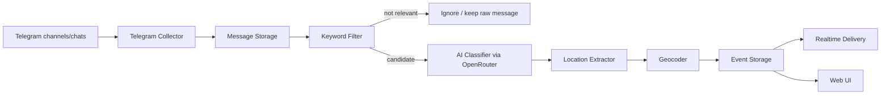

# Telegram Drone Safety Monitor

Микросервис для мониторинга Telegram-каналов и связанных с ними чатов/комментариев, поиска сообщений о возможном появлении БПЛА и передачи структурированных событий с локацией, координатами и уровнем уверенности.

Проект ориентирован на гражданскую безопасность: задача сервиса - быстрее находить сообщения, которые могут помочь жителям понять, где потенциально замечен или слышен БПЛА.

## Реализованная структура

```text
backend/      FastAPI microservice, SQLite, Telegram collector, AI/geocoder pipeline
frontend/     отдельный React/Vite dashboard с картой и realtime-лентой
data/         SQLite база при локальном/Docker запуске
```

Backend и frontend разделены. Backend отдает REST API и WebSocket, frontend работает как отдельное приложение и подключается к backend через `VITE_API_BASE`.

## Быстрый запуск через Docker

1. Создать `.env`:

```bash
cp .env.example .env
```

2. Запустить сервисы:

```bash
docker compose up --build
```

3. Открыть:

```text
Frontend: http://localhost:5173
Backend API: http://localhost:8000/api
Healthcheck: http://localhost:8000/api/health
```

По умолчанию Telegram collector и OpenRouter отключены, чтобы проект можно было поднять сразу. Для разработки backend использует локальную эвристику, если `OPENROUTER_API_KEY` не задан.

## Локальный запуск backend

```bash
cd backend
python -m venv .venv
source .venv/bin/activate
pip install -r requirements.txt
uvicorn app.main:app --reload
```

## Локальный запуск frontend

```bash
cd frontend
npm install
npm run dev
```

## Проверка без Telegram

1. В UI добавить источник:

```text
telegram_id: -1000000000000
title: Тест Москва
type: channel
city: Москва
region: Москва
```

2. В блоке "Тестовый сигнал" отправить сообщение:

```text
Слышно жужжание в районе Сокольники, похоже что-то летит
```

3. Backend прогонит сообщение через pipeline:

```text
SQLite -> keyword filter -> AI/fallback classifier -> geocoder -> event -> WebSocket -> карта
```

Если geocoder доступен, событие появится на карте. Если сеть или geocoder недоступны, событие сохранится без координат, но останется в ленте.

## Подключение Telegram

В `.env` нужно включить collector:

```env
TELEGRAM_ENABLED=true
TELEGRAM_API_ID=123456
TELEGRAM_API_HASH=your_hash
TELEGRAM_SESSION_NAME=telegram_sessions/drone_monitor
```

Collector работает только в realtime-режиме. Он обрабатывает новые сообщения, которые приходят после запуска сервиса, и не читает старую историю каналов/чатов.

При этом сервис сохраняет собственную внутреннюю историю: все новые сообщения, которые он увидел после запуска, результаты фильтрации, ответы ИИ, геокодинг, итоговые события и логи доставки. То есть backfill из Telegram не делается, но журнал обработанных сервисом данных ведется.

При первом запуске Telethon может запросить авторизацию аккаунта. На сервере удобнее один раз авторизовать session-файл локально или в интерактивном окружении, затем использовать этот session-файл при деплое.

Источники добавляются через UI или API. Telegram ID источника должен совпадать с ID канала/чата, например `-100...`. Если указан `username`, collector также сможет использовать его для подписки на события.

В UI источники выбираются из доступных Telegram-диалогов. После авторизации session нужно открыть dashboard, нажать `+` в блоке источников и выбрать каналы/чаты, которые должны мониториться. Все остальные доступные аккаунту каналы/чаты игнорируются, пока они не подключены как enabled source.

### Проверка настоящего Telegram-аккаунта

Перед запуском сервиса на сервере можно отдельно проверить Telethon session.

1. Создать `.env` и заполнить Telegram credentials:

```bash
cp .env.example .env
```

```env
TELEGRAM_API_ID=123456
TELEGRAM_API_HASH=your_hash
TELEGRAM_SESSION_NAME=telegram_sessions/drone_monitor
```

2. Установить backend-зависимости:

```bash
cd backend
python -m venv .venv
source .venv/bin/activate
pip install -r requirements.txt
cd ..
```

3. Авторизовать аккаунт и создать session:

```bash
PYTHONPATH=backend backend/.venv/bin/python -m app.cli.telegram_check login
```

Telethon запросит телефон, код из Telegram и, если включена двухфакторная защита, пароль 2FA.

4. Посмотреть доступные каналы и чаты:

```bash
PYTHONPATH=backend backend/.venv/bin/python -m app.cli.telegram_check dialogs --limit 100
```

Команда выведет строки вида:

```text
-1001234567890 | Название канала | Channel @username
```

Именно этот `-100...` ID нужно добавлять в UI/API как `telegram_id`.

5. Проверить realtime-прием новых сообщений:

```bash
PYTHONPATH=backend backend/.venv/bin/python -m app.cli.telegram_check listen --seconds 120
```

После запуска нужно отправить новое сообщение в доступный аккаунту канал/чат. Команда не читает историю, она показывает только новые входящие сообщения.

После проверки можно выбирать источники прямо в UI:

1. Запустить backend и frontend.
2. Открыть dashboard.
3. Нажать `+` рядом с блоком "Источники".
4. Найти нужный канал/чат в списке Telegram-диалогов.
5. Указать город и регион.
6. Нажать "Выбрать".

Источник появится в списке "Источники" и будет отмечен как `live`. Выключенные sources остаются в истории сервиса, но новые сообщения из них игнорируются.

## Подключение OpenRouter

```env
OPENROUTER_API_KEY=your_key
OPENROUTER_MODEL=anthropic/claude-haiku-4.5
```

Если ключ не задан, backend продолжит работать через локальную эвристику. Это удобно для тестов, но для продакшена нужно использовать OpenRouter.

## Геокодинг

По умолчанию используется Nominatim:

```env
GEOCODER_PROVIDER=nominatim
```

Для России предпочтительнее Яндекс Геокодер:

```env
GEOCODER_PROVIDER=yandex
YANDEX_GEOCODER_API_KEY=your_key
```

## Realtime delivery

События сразу отправляются:

- в WebSocket `ws://localhost:8000/api/ws/events`;
- на webhook URL из `WEBHOOK_URLS`, если они заданы.

```env
WEBHOOK_URLS=https://example.com/hook,https://example.org/hook
```

## Цель проекта

Сервис должен автоматически:

1. Читать сообщения из Telegram-каналов и чатов, к которым есть доступ у подключенного Telegram-аккаунта.
2. Фильтровать сообщения по ключевым словам и похожим формулировкам.
3. Передавать потенциально важные сообщения в ИИ через OpenRouter.
4. Получать от ИИ вердикт: связано ли сообщение с БПЛА и содержит ли полезную информацию.
5. Извлекать локацию из текста сообщения.
6. Уточнять локацию через картографический/geocoding-сервис.
7. Сохранять событие в базу.
8. Отправлять событие сразу после обнаружения.
9. Показывать подключенные каналы/чаты и найденные точки на базовом UI.

## Источники данных

Сервис работает с теми Telegram-источниками, к которым есть доступ у авторизованного аккаунта:

- публичные каналы;
- приватные каналы, если аккаунт в них состоит;
- чаты при каналах;
- комментарии/обсуждения при постах;
- отдельные группы/чаты, если они добавлены в конфигурацию.

Каждый источник привязывается к базовой географии:

```json
{
  "telegram_id": "-1000000000000",
  "title": "Тестовый канал Москва",
  "type": "channel",
  "city": "Москва",
  "region": "Москва",
  "enabled": true
}
```

Для MVP тестовыми городами считаются:

- Москва;
- Санкт-Петербург.

Тестирование будет идти на собственных каналах и чатах.

## Общая схема работы



## Первичная фильтрация

Каждое новое сообщение сначала проходит быстрый keyword-фильтр. Он нужен, чтобы не отправлять в ИИ весь поток сообщений.

Примерные ключевые слова и фразы:

```text
дрон
дроны
беспилотник
беспилотники
БПЛА
шахед
герань
мопед
жужжание
жужжит
слышен шум
слышу шум
летит
летел
пролетел
в небе
над районом
со стороны
низко летит
```

Фильтр должен учитывать:

- регистр букв;
- склонения и разные формы слов;
- короткие сообщения;
- сообщения с опечатками, если это возможно без усложнения MVP;
- контекстные фразы, например "слышу жужжание", "что-то летит", "над районом шум".

На этом этапе сервис не принимает финальное решение. Он только решает, стоит ли отправлять сообщение в ИИ.

## ИИ-анализ через OpenRouter

Сообщения, прошедшие keyword-фильтр, отправляются в OpenRouter.

ИИ должен вернуть строго структурированный JSON:

```json
{
  "is_drone_related": true,
  "confidence": 0.86,
  "event_type": "possible_drone_sighting",
  "risk_level": "medium",
  "summary": "Пользователь сообщает о звуке, похожем на БПЛА.",
  "location_text": "Пролетарский район",
  "location_precision": "district",
  "needs_geocoding": true,
  "useful_for_alert": true,
  "comment": "Точной улицы нет, но указан район."
}
```

ИИ оценивает:

- связано ли сообщение с возможным БПЛА;
- является ли это реальным наблюдением, вопросом, шуткой, слухом или пересказом;
- есть ли полезная локация;
- какой уровень точности локации;
- нужно ли создавать событие;
- насколько можно доверять сообщению.

## Локация и уровни точности

У каждого Telegram-источника есть базовая локация. Если сообщение не содержит ничего точнее, событие привязывается к городу источника.

Например:

```text
Канал: Тестовый канал Москва
Базовая локация: Москва
Сообщение: "Слышу жужжание, что-то летит"
Итог: Москва, точность city
```

Если пользователь указывает район, улицу, населенный пункт или ориентир, сервис сужает локацию:

```text
Сообщение: "Слышно жужжание в Пролетарском районе"
Итог: Москва/город канала + Пролетарский район, точность district
```

Уровни точности:

| Уровень | Описание |
| --- | --- |
| `city` | Известен только город, привязанный к каналу/чату |
| `district` | Указан район города |
| `settlement` | Указан поселок, деревня, пригород или населенный пункт |
| `street` | Указана улица |
| `address` | Указан точный адрес или дом |
| `landmark` | Указан ориентир: ТЦ, парк, школа, вокзал, станция и т.п. |
| `unknown` | Локацию определить нельзя |

## Геокодинг и карты

Для MVP лучше выбрать самый простой и надежный вариант, который быстро подключается и нормально работает по России.

Приоритет:

1. **Яндекс Геокодер** - хороший вариант для России, понятные адреса, районы, улицы и координаты.
2. **2ГИС** - хороший вариант для городских объектов и организаций.
3. **OpenStreetMap/Nominatim** - можно использовать как бесплатный fallback, но качество по локальным адресам может быть нестабильным.

Для первой версии предлагается использовать Яндекс Геокодер, если есть API-ключ. Если ключа нет, начать с Nominatim как временного варианта.

Геокодер получает нормализованную строку:

```text
Москва, Пролетарский район
```

И возвращает:

```json
{
  "query": "Москва, Пролетарский район",
  "formatted_address": "Россия, Москва, Пролетарский район",
  "lat": 55.733,
  "lon": 37.665,
  "precision": "district",
  "provider": "yandex"
}
```

## Итоговое событие

Сервис должен создавать событие примерно такого вида:

```json
{
  "id": "evt_123",
  "created_at": "2026-06-02T12:30:00Z",
  "source": {
    "telegram_chat_id": "-1000000000000",
    "telegram_message_id": 12345,
    "source_title": "Тестовый канал Москва",
    "source_type": "channel"
  },
  "classification": {
    "is_drone_related": true,
    "confidence": 0.86,
    "risk_level": "medium",
    "event_type": "possible_drone_sighting"
  },
  "location": {
    "city": "Москва",
    "region": "Москва",
    "district": "Пролетарский район",
    "address": null,
    "landmark": null,
    "lat": 55.733,
    "lon": 37.665,
    "precision": "district",
    "formatted_address": "Россия, Москва, Пролетарский район"
  },
  "text": "Слышно жужжание в Пролетарском районе",
  "summary": "Пользователь сообщает о звуке, похожем на БПЛА.",
  "comment": "Точной улицы нет, но указан район."
}
```

## Realtime-отправка событий

События должны отправляться сразу после обнаружения.

Для MVP можно сделать несколько каналов доставки:

- WebSocket для UI;
- webhook на внешний URL;
- опционально Telegram-бот для уведомлений в отдельный служебный чат;
- REST API для получения истории событий.

Минимальный вариант:

```text
Новое сообщение -> фильтр -> ИИ -> геокодинг -> запись в SQLite -> отправка в WebSocket -> отображение на карте
```

## UI для визуализации

Для первой версии нужен базовый, но наглядный интерфейс.

Основные экраны:

1. **Карта событий**
   - точки найденных событий;
   - цвет точки по уровню риска;
   - клик по точке открывает карточку события;
   - в карточке видны текст сообщения, источник, уверенность ИИ, время и адрес.

2. **Подключенные каналы и чаты**
   - список подключенных источников;
   - тип источника: канал, чат, комментарии;
   - город/регион;
   - статус: активен, отключен, ошибка подключения;
   - количество обработанных сообщений;
   - количество найденных событий.

3. **Лента событий**
   - новые события сверху;
   - фильтр по городу;
   - фильтр по уровню риска;
   - фильтр по точности локации;
   - быстрый переход от события к точке на карте.

4. **Настройки**
   - управление списком Telegram-источников;
   - привязка источника к городу;
   - настройка ключевых слов;
   - настройка OpenRouter;
   - настройка геокодера;
   - настройка webhook/уведомлений.

Для MVP UI можно сделать как простую web-страницу внутри FastAPI:

- backend: FastAPI;
- frontend: HTML/CSS/JS или легкий React/Vite, если понадобится удобнее;
- карта: Leaflet;
- realtime: WebSocket.

## Основные компоненты

### 1. Telegram Collector

Отвечает за:

- авторизацию Telegram-аккаунта;
- чтение каналов и чатов;
- получение новых сообщений;
- обработку связанных discussion-ч чатов;
- защиту от повторной обработки;
- передачу сообщений в pipeline.

Библиотека для MVP:

```text
Telethon
```

### 2. Keyword Filter

Отвечает за:

- быстрый поиск ключевых слов;
- регулярные выражения;
- нормализацию текста;
- принятие решения, отправлять ли сообщение в ИИ.

### 3. AI Classifier

Отвечает за:

- запросы к OpenRouter;
- промпт для классификации;
- строгий JSON-ответ;
- повторную попытку при невалидном JSON;
- сохранение результата классификации.

### 4. Location Resolver

Отвечает за:

- объединение базовой локации канала с локацией из сообщения;
- нормализацию адресной строки;
- определение уровня точности;
- подготовку запроса для геокодера.

### 5. Geocoder

Отвечает за:

- запрос к картографическому API;
- получение координат;
- нормализованный адрес;
- оценку качества результата;
- fallback, если основной сервис недоступен.

### 6. Storage

Для MVP достаточно SQLite.

Основные сущности:

- `sources` - Telegram-источники;
- `messages` - новые сообщения, которые сервис увидел после запуска;
- `classifications` - результаты фильтрации и ИИ-анализа;
- `geocoding_results` - результаты геокодинга;
- `events` - итоговые события;
- `delivery_logs` - история отправки событий.

Важно: `messages` не является импортированной историей Telegram. Это внутренняя история сервиса, сформированная только из новых входящих сообщений.

### 7. API

REST API:

```http
GET /health
GET /sources
POST /sources
PATCH /sources/{id}
GET /messages
GET /events
GET /events/{id}
GET /telegram/dialogs
POST /telegram/connect
POST /webhooks/test
```

WebSocket:

```http
WS /ws/events
```

## Предлагаемый стек для MVP

Backend:

- Python;
- FastAPI;
- Telethon;
- SQLite;
- SQLAlchemy;
- Pydantic;
- httpx;
- OpenRouter API;
- Яндекс Геокодер или Nominatim.

Frontend:

- FastAPI static files или React/Vite;
- Leaflet для карты;
- WebSocket для новых событий;
- простой dashboard по источникам.

## MVP

Первая рабочая версия должна уметь:

1. Авторизоваться в Telegram через аккаунт.
2. Читать заданные каналы/чаты.
3. Обрабатывать только новые сообщения, пришедшие после запуска сервиса.
4. Хранить список источников с привязкой к городу.
5. Обрабатывать новые сообщения без дублей.
6. Фильтровать сообщения по ключевым словам.
7. Отправлять кандидатов в OpenRouter.
8. Получать структурированный JSON-вердикт.
9. Извлекать и уточнять локацию.
10. Геокодировать локацию.
11. Создавать событие.
12. Сразу отправлять событие через WebSocket.
13. Показывать событие на карте.
14. Показывать список подключенных каналов/чатов.

## Дальнейшие улучшения

После MVP можно добавить:

- дедупликацию похожих сообщений в один инцидент;
- кластеризацию событий рядом по времени и координатам;
- отдельные уровни достоверности источников;
- автообновление словаря ключевых слов;
- ручную модерацию событий;
- подтверждение/опровержение события;
- историю перемещения по нескольким сообщениям;
- интеграцию с несколькими картографическими сервисами;
- роли пользователей в UI;
- экспорт событий;
- уведомления в Telegram-бота;
- очередь задач через Redis/Celery или Dramatiq.

## Важные ограничения

Сервис не должен:

- помогать с наведением, поражением или перехватом объектов;
- выдавать военные рекомендации;
- использоваться для координации атак;
- делать выводы без указания уровня уверенности.

Сервис должен:

- показывать, что данные получены из пользовательских сообщений;
- сохранять исходный текст;
- показывать уверенность ИИ;
- отличать точный адрес от примерной зоны;
- не скрывать, если локация определена только на уровне города.
